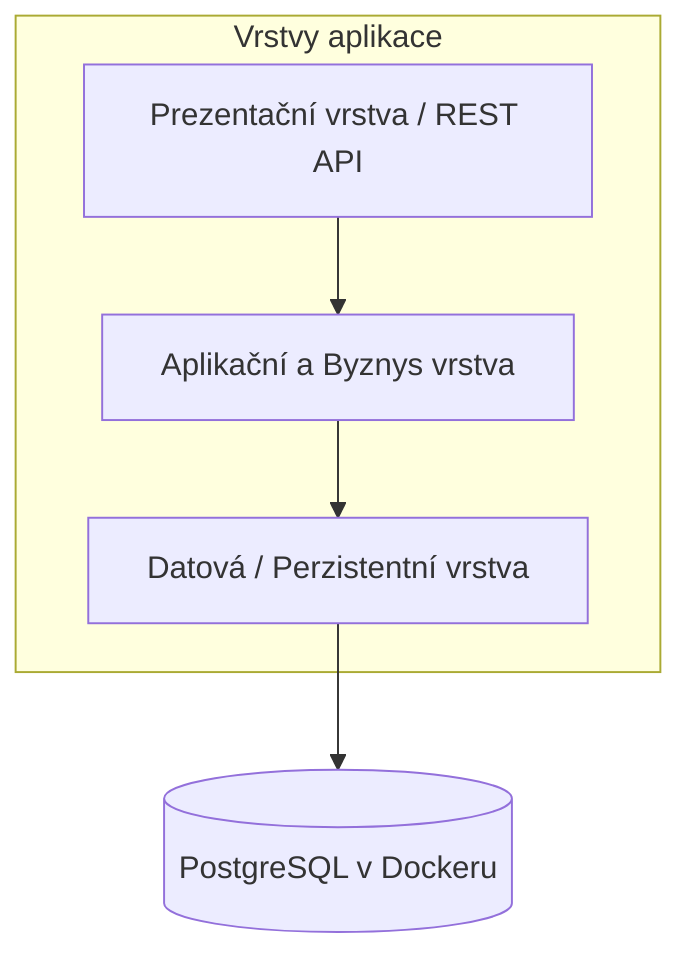
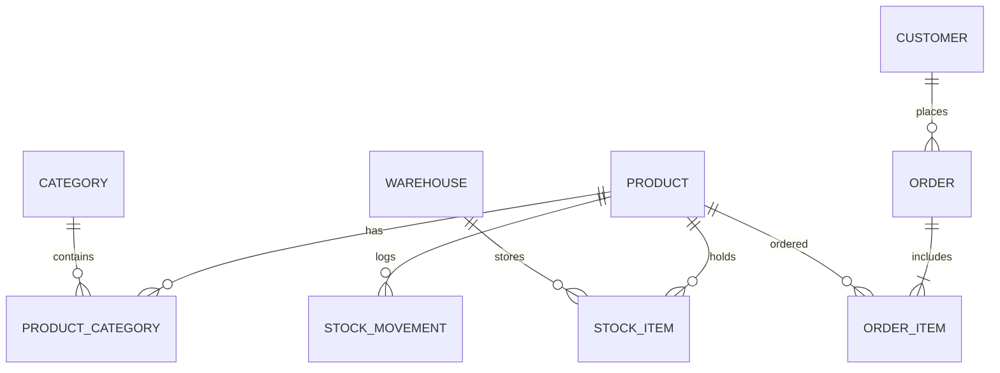

# Sklad pro malý e-shop (Dřevěnka s.r.o.)
> **Semestrální projekt předmětu Pokročilé programování (PPRO)**  
> **Fakulta informatiky a managementu, Univerzita Hradec Králové (ZS 2026/2027)**  
> **Zvolené zadání:** Zadání B – Sklad pro malý e-shop  
> **Klient:** Dřevěnka s.r.o.  
> **Role klienta na cvičení:** Vyučující předmětu PPRO

---

## 📌 1. O projektu a zadání klienta

### 1.1 Kontext klienta
Společnost **Dřevěnka s.r.o.** podniká deset let s prodejem kvalitních dřevěných hraček. V posledních třech letech jí rostou tržby a naráží na limity současného provizorního řešení.

- **Současný stav:**
  - Jeden Excel soubor se cca 400 položkami, otevřený současně na třech různých počítačích (časté kolize a nekonzistence).
  - Zásoby jsou rozděleny do **dvou skladů**:
    1. **Hlavní sklad v Hradci Králové** (běžný provoz a expedice).
    2. **Sklad v Třebechovicích pod Orebem** (fakticky garáž, kam se odkládá sezónní zboží a zásoby).
  - Objednávky přicházejí z e-shopu do e-mailu a do Excelu se přepisují ručně.
- **Kritický problém klienta:**
  - Přibližně 2× do měsíce se prodá zboží, které ve skutečnosti není na skladě. Následuje trapné telefonické omlouvání zákazníkům, což klient označuje za nejhorší část své práce.
  - Chybí jakákoliv evidence přesunů mezi garáží a Hradcem Králové a dohledatelnost skladových pohybů.

---

### 1.2 Co klient chce (Funkční požadavky)
1. **Produkty a kategorie:**
   - Každý produkt má název, kód (SKU), popis, nákupní cenu a prodejní cenu.
   - Podpora více kategorií na produkt (vazba M:N): např. jedna káča patří současně do kategorií *„pro batolata“* a *„dárky do 500 Kč“*.
2. **Zásoby po skladech:**
   - U každého produktu musí být přehledně vidět stav zásoby: kolik kusů je v Hradci Králové a kolik v garáži v Třebechovicích.
3. **Objednávky zákazníků:**
   - Objednávka obsahuje údaje o zákazníkovi, datum vzniku, stav zpracování a jednotlivé položky (objednané množství a cena, za kterou bylo prodáno).
4. **Odmítnutí objednávky při nedostatku zásob:**
   - Klíčová funkce zabraňující prodeji neexistujícího zboží. Pokud není k dispozici dostatek zásob, objednávka nesmí být přijata k expedici.
5. **Dohledání pohybu (Auditní stopa):**
   - Ke každému výdeji a příjmu musí být dohledatelné, ze kterého skladu bylo vydáno/přijato. Možnost odpovědět na otázku *„kde je ta káča, co jsem ji měl minulý týden“*.
6. **Přesun mezi sklady:**
   - Funkce pro evidenci převozu zboží ze zimní garáže v Třebechovicích do hlavního skladu v Hradci Králové a naopak.
7. **Minimální zásoba a doobjednání:**
   - Každý produkt má definovanou minimální bezpečnou zásobu. Seznam produktů pod tímto limitem je zobrazen prioritně na hlavní stránce / dashboardu.
8. **Měsíční obrat po kategoriích:**
   - Přehled a statistika tržeb za zvolený měsíc rozpadlá podle jednotlivých kategorií produktů (*„co klienta živí“*).

---

### 1.3 Na čem klient trvá (Obchodní pravidla a invarianty)
- ❌ **Vydat víc, než je na skladě, nesmí jít za žádných okolností.** Ani omylem, ani ručně.
- 🔒 **Cena v odeslané objednávce se nesmí zpětně změnit**, pokud dojde k úpravě ceníku či ceny produktu v katalogu.
- 📜 **Každá změna stavu zásob musí být zpětně dohledatelná** s přesným časem, důvodem a skladem (*„Chci vidět, proč jich je sedmnáct a ne dvacet.“*).
- 👤 **Zákazník se z databáze nikdy nemaže**, protože se k objednávkám vrací při reklamacích a dotazech.

---

### 1.4 Co klient prohodil mimochodem (Podružná přání)
- *„Poštovné řešit nemusíme, to počítá e-shop.“* $\rightarrow$ Skladový systém neřeší kalkulaci dopravného.
- *„Ať to jde používat i z mobilu, já jsem půlku dne ve skladu.“* $\rightarrow$ Responzivní, ergonomické rozhraní použitelné na mobilním telefonu či tabletu skladníka.
- *„Faktury zatím ne, ale jednou určitě.“* $\rightarrow$ Systém je navržen rozšiřitelně, ale fakturace není součástí první verze.
- *„Nejradši bych to měl barevně, ať vidím, co hoří.“* $\rightarrow$ Vizuální indikátory (červená pro stav pod minimem, žlutá pro blížící se minimum, zelená pro dostatek).

---

## ⚖️ 2. Rozhodnutí k otevřeným bodům zadání

Dle pokynů k semestrálnímu projektu obsahuje tato sekce konkrétní rozhodnutí s odůvodněním k pěti otevřeným bodům zadání B:

### 1. Objednávka ze dvou skladů naráz
- **Rozhodnutí:** Systém umožňuje odbavit objednávku rozdělením na dílčí skladové výdejky pro jednotlivé sklady (split fulfillment), pokud celková disponibilní zásoba pokrývá objednávku, ale žádný samostatný sklad nemá všechny položky. Systém zároveň nabídne možnost vygenerovat interní přesun z garáže do Hradce Králové pro expedici z jednoho místa.
- **Odůvodnění:** E-shop nesmí zbytečně odmítat platícího zákazníka, pokud zboží reálně existuje na skladech Dřevěnky; poštovné navíc dle vyjádření klienta řeší samotný e-shop, takže skladový systém se soustředí na přesnou evidenci toho, ze kterého skladu jaké zboží fyzicky odešlo.

### 2. Co znamená „dost zásob“ (Okamžik odečtení zásoby a rezervace)
- **Rozhodnutí:** Zavádíme dvoufázové řízení skladové dostupnosti:
  $$\text{Disponibilní zásoba} = \text{Fyzická zásoba na skladě} - \text{Rezervováno rozpracovanými objednávkami}$$
  Zásoba se okamžitě **rezervuje** při přijetí/zaplacení objednávky (což okamžitě sníží disponibilní zásobu pro další nákupy), zatímco fyzický odpis z regálu a zápis výdejového pohybu nastává až při **expedici zboží**.
- **Odůvodnění:** Okamžitá rezervace spolehlivě eliminuje hlavní bolest klienta (prodej zboží, které již bylo slíbeno někomu jinému), zatímco fyzický stav na skladě přesně odpovídá tomu, co skladník vidí v regálu až do okamžiku zabalení do balíku.

### 3. Záporný stav a inventura
- **Rozhodnutí:** Výdej do záporného stavu je v celém systému striktně zakázán na úrovni databázových integritních omezení i servisní logiky. Neshody v garáži (kde stav „nikdy nesedí“) se řeší výhradně modulem **Inventura**, který po přepočítání vygeneruje auditovaný inventurní pohyb (manko / přebytek) s povinným zdůvodněním a narovná stav na zjištěnou realitu.
- **Odůvodnění:** Zajišťuje se stoprocentní splnění klientovy podmínky *„Vydat víc, než je na skladě, nesmí jít“*, přičemž klient získává legitimní, plně dohledatelný nástroj k pravidelnému vyčištění a srovnání nesrovnalostí v třebechovické garáži.

### 4. Varianty produktu
- **Rozhodnutí:** Každá fyzicky odlišitelná varianta (např. *káča červená*, *káča modrá*, *káča přírodní*) je vedena jako samostatná skladová položka (`Product`) s vlastním unikátním SKU kódem, čárovým kódem a nezávislou skladovou zásobou, přičemž je provázána vazbou na společnou skupinu produktů (`ProductGroup` / rodina modelu) pro společný popis a prezentaci.
- **Odůvodnění:** Skladník potřebuje vědět přesný počet kusů každé konkrétní barvy v daném regálu; sloučení variant do jednoho beztvarého produktu by vedlo k chybám při expedici a neschopnosti garantovat dostupnost konkrétní varianty.

### 5. Změna objednávky po zaplacení
- **Rozhodnutí:** Objednávku je povoleno upravit (změnit položky nebo množství) pouze ve stavu `Zaplaceno / Čeká na zpracování`. Při úpravě systém uvolní původní rezervace, ověří dostupnost nových položek, vytvoří nové rezervace a vyčíslí přeplatek/nedoplatek. Jakmile je objednávka přepnuta do stavu `Ve vychystávání` nebo `Expedováno`, je pro přímé změny uzamčena a další požadavky se řeší standardní novou objednávkou nebo vratkou.
- **Odůvodnění:** Zabraňuje se chaosu ve skladu, aby skladník nebyl zmaten změnou objednávky v momentě, kdy ji již drží v ruce a balí, a současně umožňuje klientovi vyjít vstříc zákazníkovi, který zavolá bezprostředně po nákupu.

### 6. Evidence doobjednání u dodavatele (Zboží na cestě)
- **Rozhodnutí:** Systém zavádí sledování objednaného zboží u truhláře/výrobce (`incomingQuantity` – zboží na cestě). Pokud disponibilní zásoba poklesne pod minimální bezpečnou mez, ale skladník již zboží prokazatelně doobjednal (`incomingQuantity > 0`), systém nehlásí kritický poplach červenou barvou, nýbrž klidový modrý informativní stav *„Objednáno u dodavatele (na cestě X ks)“*. Skladník může zboží doobjednat přímo z rozhraní a po doručení balíku provést naskladnění do konkrétního skladu (Hradec Králové / Třebechovice), čímž se kusy převedou do fyzické zásoby.
- **Odůvodnění:** Odstraňuje zbytečný stres na skladě, zamezuje duplicitním objednávkám u truhláře od různých zaměstnanců a poskytuje okamžitou jistotu, že vyřešení nízké zásoby je již na cestě.

---

## 🏗️ 3. Architektura a technický návrh

Systém je navržen dle požadavků předmětu PPRO na **třívrstvou architekturu se striktně jednosměrnými závislostmi**:



### 3.1 Datový model a entity (minimálně 5 entit + vazba M:N)
Navržený model obsahuje 8 provázaných entit pokrývajících celou doménu:

1. **`Product` (Produkt / Varianta):**
   - `id`, `sku_code`, `name`, `description`, `purchase_price`, `selling_price`, `min_stock_level`, `product_group_id`, `created_at`
2. **`Category` (Kategorie):**
   - `id`, `name`, `slug`, `description`
3. **`ProductCategory` (Vazební entita M:N):**
   - `product_id`, `category_id` (spojuje produkty a kategorie)
4. **`Warehouse` (Sklad):**
   - `id`, `code` (HRADEC / TREBECHOVICE), `name`, `address`, `is_active`
5. **`StockItem` (Stav zásoby na skladu):**
   - `id`, `product_id`, `warehouse_id`, `physical_quantity`, `reserved_quantity`
   - *Integritní omezení:* `physical_quantity >= 0`, `reserved_quantity >= 0`, `reserved_quantity <= physical_quantity`
6. **`StockMovement` (Kniha skladových pohybů / Audit log):**
   - `id`, `product_id`, `source_warehouse_id` (nullable), `target_warehouse_id` (nullable), `type` (RECEIPT, DISPATCH, TRANSFER, INVENTORY_ADJUSTMENT), `quantity`, `reference_order_id` (nullable), `note`, `created_at`
7. **`Customer` (Zákazník):**
   - `id`, `first_name`, `last_name`, `email`, `phone`, `street`, `city`, `zip`, `created_at` (nemaže se)
8. **`Order` (Objednávka):**
   - `id`, `order_number`, `customer_id`, `status` (CREATED, RESERVED, PROCESSING, DISPATCHED, CANCELLED), `total_price`, `created_at`
9. **`OrderItem` (Položka objednávky):**
   - `id`, `order_id`, `product_id`, `warehouse_id`, `quantity`, `unit_price_at_purchase` (zafixovaná prodejní cena v době koupě)



---

## 📋 4. Kontrolní checklist povinného minima PPRO

| Požadavek | Stav | Poznámka k realizaci |
| :--- | :---: | :--- |
| **Tři vrstvy se závislostmi jedním směrem** | ✅ Hotovo | `*Controller` $\rightarrow$ `*Service` $\rightarrow$ `*Repository` (žádné obcházení vrstev) |
| **Relační databáze v Dockeru** | ✅ Připraveno | PostgreSQL 16 kontejner v `docker-compose.yml` s perzistentním volume |
| **Databázové migrace** | ✅ Hotovo | 6 verzovaných Flyway migrací (`V1` až `V6`) |
| **Nejméně 5 entit** | ✅ Hotovo | **7 plnohodnotných entit:** `Product`, `Category`, `Warehouse`, `StockItem`, `Customer`, `Order`, `OrderItem` |
| **Alespoň jedna vazba M:N** | ✅ Hotovo | Plně funkční vazba M:N mezi `Product` a `Category` (`product_categories`) v DB i v JPA modelu |
| **Automatizované testy** | ✅ Hotovo | **28 automatizovaných testů** (unit testy byznys pravidel, doobjednávek, rezervací, split fulfillmentu, odmítnutí prodeje neexistujícího zboží, integrační testy REST API a kontextu) |
| **Spuštění příkazem `docker compose up`** | ✅ Hotovo | Multi-stage `Dockerfile` (s cache závislostí a healthcheckem) a `docker-compose.yml` s izolovanou bridge sítí a perzistentním volume |
| **Technická dokumentace v README.md** | ✅ Hotovo | Detailní zadání, pravidla, rozhodnutí k otevřeným bodům, technický deník (SSOT) |
| **Syntetická data (žádné osobní/citlivé údaje)** | ✅ Zajištěno | Výhradně fiktivní sortiment dřevěných hraček a fiktivní zákazníci Dřevěnky s.r.o. |

---

## 🛠️ 5. Technologický stack (Potvrzeno)

Systém je postaven na moderním, robustním a typovém stacku splňujícím veškerá akademická i průmyslová kritéria PPRO:
- **Jazyk & Runtime:** Java 21+ (Java 25 LTS).
- **Backend / Aplikační rámec:** Spring Boot 3.x (Spring Web, Spring Data JPA, Jakarta Validation).
- **Databáze:** PostgreSQL 16 (běžící v Dockeru).
- **Databázové migrace:** Flyway (verzované SQL skripty `V1__...`, `V2__...`).
- **Dokumentace API:** SpringDoc OpenAPI 3 / Swagger UI (`/swagger-ui.html`).
- **Frontend / Webové rozhraní:** Vanilla HTML5 + CSS3 + JavaScript (ES2022+) servírovaný ze `src/main/resources/static/`.
  - *Odůvodnění:* Není potřeba separátní buildovací nástroj (Webpack, Vite apod.) ani Node.js runtime. Statické soubory jsou přímo součástí Spring Boot JARu. Rozhraní volá REST API asynchronně přes `fetch()`. Google Fonts (Inter) pro moderní typografii. CSS Custom Properties pro design systém (dark mode, barvy stavu zásoby). Přístup je vhodný pro akademický projekt s důrazem na jednoduché spuštění (`docker compose up`).
- **Kontejnerizace:** Docker & Docker Compose (`docker compose up --build`).
- **Implementační plán:** Kompletní plán s odškrtávacím seznamem je v souboru [IMPLEMENTATION_PLAN.md](file:///c:/Dokumenty/Škola/Vysoká/PPRO/PPRO/IMPLEMENTATION_PLAN.md).

---

## ⚙️ 6. Návod na zprovoznění a spuštění

### Prerekvizity:
- Docker Desktop & Docker Compose (nebo lokální Java 21+ a Maven)
- Git

### Možnost A: Spuštění v kontejneru přes Docker Compose (Doporučeno pro obhajobu)
Celé prostředí (PostgreSQL databáze + backend + webové UI + inicializační Flyway migrace) naběhne jediným příkazem:
```bash
docker compose up -d
```
Po naběhnutí je systém dostupný:
- **Webový informační systém skladu:** [http://localhost:8080](http://localhost:8080)
- **Interaktivní Swagger UI dokumentace API:** [http://localhost:8080/swagger-ui.html](http://localhost:8080/swagger-ui.html)
- **OpenAPI specifikace JSON:** [http://localhost:8080/api-docs](http://localhost:8080/api-docs)

Zastavení kontejnerů:
```bash
docker compose down
```

### Možnost B: Lokální vývojové spuštění (Profil `h2`)
Pro rychlé lokální testování bez nutnosti běžícího Dockeru či PostgreSQL:
```bash
cd backend
mvn spring-boot:run
```
Aplikace použije in-memory H2 databázi, Flyway automaticky provede migrace a vloží syntetická data.

### Spuštění automatizovaných testů:
```bash
cd backend
mvn test
```

---

## 📈 7. Záznamy postupu a technický deník (Changelog)

- **2026-09-30:**
  - Inicializace Git repozitáře a napojení na remote `origin` (`https://github.com/Miskoslav/PPRO.git`).
  - Analýza oficiálního zadání PPRO (ZS 2026/2027) a volba **Zadání B: Sklad pro malý e-shop (Dřevěnka s.r.o.)**.
  - Vypracování [AGENTS.md](file:///c:/Dokumenty/Škola/Vysoká/PPRO/PPRO/AGENTS.md) s kodifikací zásad: zákaz samovolných commitů bez výslovného pokynu, README.md jako jediný zdroj pravdy (SSOT), automatické pre-commit hooky.
  - Implementace Git `pre-commit` hooku kontrolujícího přítomnost aktualizace `README.md` před každým commitem (`.githooks/pre-commit`).
  - Vytvoření kompletní technické dokumentace a řešení všech 5 otevřených bodů zadání v [README.md](file:///c:/Dokumenty/Škola/Vysoká/PPRO/PPRO/README.md).
  - Anonymizace a odstranění osobních údajů a e-mailových adres z dokumentace a konfiguračních souborů.
  - Doplnění Zásady 1b do [AGENTS.md](file:///c:/Dokumenty/Škola/Vysoká/PPRO/PPRO/AGENTS.md) o povinnosti detailních, strukturovaných a vypovídajících commit zpráv.
  - Zvolen technologický stack: **Java (Spring Boot 3) + PostgreSQL + Flyway + Docker Compose**.
  - Doplnění Zásad 7 a 8 do [AGENTS.md](file:///c:/Dokumenty/Škola/Vysoká/PPRO/PPRO/AGENTS.md) (důsledné komentování kódu a správa úkolů přes odškrtávací seznam).
  - Vytvořen kompletní [IMPLEMENTATION_PLAN.md](file:///c:/Dokumenty/Škola/Vysoká/PPRO/PPRO/IMPLEMENTATION_PLAN.md) přímo v projektu pro Milestone 1 (demo entity `Product`).

- **2026-10-07:**
  - První úspěšné spuštění aplikace (Spring Boot + H2 in-memory DB, profil `h2`).
  - Přidán `HealthController` s endpointem `GET /api/v1/health` – smoke-test REST API.
  - Vytvořen kompletní webový frontend (Vanilla HTML/CSS/JS, dark mode, responzivní SPA layout) v `src/main/resources/static/index.html`.
  - Doplněn Javadoc do `WarehouseApplication.java` a `HealthController.java`.
  - Přidán `@ActiveProfiles("h2")` do integračního testu – `contextLoads()` prochází bez PostgreSQL.
  - Zaznamenáno rozhodnutí o frontendové technologii (Vanilla JS bez buildovacího nástroje) do sekce Technologický stack.
  - Kodifikována **Zásada 9** v `AGENTS.md`: Uživatelské rozhraní bez AI klišé (odstraněny emotikony, blikající tečky, technický žargon Swagger z klientského UI; přechod na čistý, profesionální firemní design).
  - Přesunut online indikátor ze sidebaru / Dashboardu do sekce Informace o systému.
  - Odškrtnuta Fáze 1 (Inicializace projektu a Maven konfigurace) v `IMPLEMENTATION_PLAN.md`.

- **2026-11-11:**
  - **Dokončen Milestone 1:** Kompletní vertikální realizace klíčové entity `Product` (od DB přes servisní vrstvu až po REST API a frontend).
  - **Fáze 2 (Databázová vrstva):**
    - Vytvořena Flyway DDL migrace `V1__create_products_table.sql` pro tabulku `products` s integritními omezeními (unikátní SKU kód, CHECK na nezáporné ceny a minimální skladovou zásobu).
    - Vytvořena seedovací migrace `V2__seed_demo_products.sql` s 5 autentickými syntetickými položkami sortimentu Dřevěnky (káča, vláček, bukové kostky, domeček pro panenky, tahací pejsek).
    - Implementována JPA entita `Product` se striktními Javadoc komentáři, timestampy (`@PrePersist`, `@PreUpdate`) a soft-delete příznakem `isActive`.
    - Vytvořen Spring Data JPA repozitář `ProductRepository` s vyhledáváním dle SKU a filtrem položek s minimální bezpečnou zásobou.
  - **Fáze 3 (Byznys vrstva):**
    - Vytvořeny přepravky dat `ProductCreateDto`, `ProductUpdateDto` a `ProductResponseDto` (s kalkulací absolutní a procentuální marže).
    - Vytvořena hierarchie doménových výjimek: `ResourceNotFoundException` (404), `DuplicateSkuException` (409), `BusinessValidationException` (422) a `ErrorResponse` ve stylu RFC 7807 Problem Details.
    - Implementován `GlobalExceptionHandler` pro jednotné a bezpečné zpracování chyb a validačních selhání formulářů.
    - Implementováno rozhraní `ProductService` a servisní třída `ProductServiceImpl` ošetřující pravidla unikátnosti SKU a zákazu záporné marže.
  - **Fáze 4 (Prezentační vrstva & UI):**
    - Implementován REST Controller `ProductController` s kompletní sadou CRUD endpointů a pohledem na položky pod limitem minimální zásoby (`/alerts/low-stock`).
    - Nastavena OpenAPI 3 / Swagger dokumentace v konfigurační třídě `OpenApiConfig`.
    - Do webového rozhraní `index.html` integrován modální formulář pro přidání nové dřevěné hračky s okamžitým zobrazením validačních hlášek u jednotlivých polí (bez AI klišé, seriózní firemní vzhled).
  - **Fáze 5 (Kontejnerizace):**
    - Vytvořen multi-stage `Dockerfile` s buildem přes Maven a minimálním runtime Eclipse Temurin JRE 21 s neprivilegovaným uživatelem.
    - Vytvořen `docker-compose.yml` orchestrující PostgreSQL 16 kontejner s perzistentním volume a healthcheckem a backendovou aplikaci.
  - **Fáze 6 (Testování):**
    - Vytvořeny unit testy `ProductServiceTest` (9 testovacích scénářů pokrývajících unikátnost SKU, kalkulaci marží, soft-delete, doobjednávky a výjimky).
    - Vytvořeny integrační testy `ProductControllerTest` (12 testů testujících REST API a HTTP stavové kódy 200, 201, 400, 404, 409, 422 včetně endpointů order-supply a receive-supply).
    - Všech 22 automatizovaných testů úspěšně prochází (`BUILD SUCCESS`).
  - **Fáze 7 (Dokumentace & Plán):**
    - Aktualizován implementační plán `IMPLEMENTATION_PLAN.md` (odškrtnuty všechny body Milestone 1).
    - Zaznamenán postup a návody do `README.md`.
  - **Rozšíření Milestone 2 (Stavy zásob, sklady, kategorie M:N a doobjednávky):**
    - **Reálné počty zásob po skladech:** Vytvořena migrace `V3__create_warehouses_categories_and_stock.sql` a seedovací migrace `V4__seed_warehouses_categories_and_stock.sql`. Sortiment má nyní realistické skladové zásoby: Káča (30 ks celkem: 18 Hradec, 12 Třebechovice – stav V pořádku), Kostky (34 ks celkem – stav V pořádku), Pejsek Bobík (25 ks celkem – stav V pořádku), Vláček (13 ks celkem – Nízký stav) a Domeček pro panenky (3 ks celkem, min limit 3 ks, ale 5 ks je na cestě od truhláře).
    - **Zboží na cestě (Doobjednání u dodavatele):** Doplněna evidence `incomingQuantity` a nový stav zásoby `ON_ORDER` (klidný modrý badge *„Na cestě (X ks)“*). Pokud je zásoba pod minimem, ale zboží je již doobjednáno, systém nestraší červeným poplachem.
    - **Operace doobjednání a naskladnění:** Implementovány endpointy `POST /api/v1/products/{id}/order-supply` a `POST /api/v1/products/{id}/receive-supply` se servisní logikou v `ProductServiceImpl`.
    - **Interaktivní UI:** Do webového rozhraní přidány dialogy pro okamžité doobjednání hračky u dodavatele a pro fyzické naskladnění doručené zásilky na zvolený sklad (Hradec Králové vs. Třebechovice) s dynamickou aktualizací rozpadu zásob.
    - **Nové entity a repozitáře:** Vytvořeny entity `Warehouse`, `Category` (vazba M:N přes `product_categories`), `StockItem` a jejich Spring Data JPA repozitáře.
    - **Testovací pokrytí:** Testovací sada rozšířena na **22 automatizovaných testů** (všechny prochází na 100 %).

- **2026-11-18:**
  - **Dokončen Milestone 3 (Zákazníci, objednávky, dvoufázový rezervační model) & dotažení evaluace:**
    - **Kritický bod zadání B realizován:** Implementován rezervační mechanismus, který atomicky rezervuje skladovou zásobu (`reserved_quantity++`) při zadání objednávky a zamezuje prodeji neexistujícího zboží (hlavní bolest klienta).
    - **Migrace V5 a V6:** DDL tabulek `customers`, `orders` (stavy `CREATED`, `RESERVED`, `PROCESSING`, `DISPATCHED`, `CANCELLED`) a `order_items` se zafixovanou prodejní cenou `unit_price_at_purchase` + syntetický seed.
    - **Nové entity a repozitáře (celkem 7 entit):** `Customer`, `Order`, `OrderItem` včetně JPA repozitářů `CustomerRepository`, `OrderRepository` a `OrderItemRepository`.
    - **Servisní vrstva:** `OrderService` a `OrderServiceImpl` (ověření disponibilní zásoby, vygenerování `ORD-YYYY-XXXXX`, fixace cen, atomická rezervace, možnost storna s uvolněním rezervace).
    - **REST API:** `OrderController` (`GET /api/v1/orders`, `GET /api/v1/orders/{id}`, `POST /api/v1/orders`, `POST /api/v1/orders/{id}/cancel`) a `CustomerController` (`GET /api/v1/customers`).
    - **Oprava naskladnění (Validation Fix):** Ošetřena nahlášená chyba – nyní nelze naskladnit více kusů, než kolik bylo u truhláře skutečně objednáno (`quantity <= incomingQuantity`), jak na úrovni backendové validace (HTTP 422), tak v klientském rozhraní s nápovědou a maximem.
    - **Přiřazení kategorií při vytváření produktu:** `ProductCreateDto` a `ProductServiceImpl` rozšířeny o `categoryIds` (vazba M:N). Ve formuláři nového produktu byl přidán výběr kategorií.
    - **Vylepšení skladů a inventář:**
      - Vytvořena servisní třída `WarehouseServiceImpl` a DTO modely `WarehouseSummaryDto`, `WarehouseInventoryItemDto`, `WarehouseCreateDto`.
      - Endpointy `GET /api/v1/warehouses/summary` (součty fyzických, rezervovaných a volných zásob) a `GET /api/v1/warehouses/{id}/inventory` (podrobný inventář daného skladu).
      - Do webového rozhraní přidána možnost rozkliknout sklad a zobrazit jeho kompletní inventář v samostatné tabulce a možnost přidat další sklad.
    - **Vylepšení Dashboardu a Upozornění zásob:**
      - V boxech skladů na Dashboardu i na stránce Sklady se nyní dynamicky zobrazují skutečné agregované počty (fyzicky, rezervováno, disponibilní).
      - Na Dashboard i na stránku Upozornění zásob byl přidán dedikovaný oddíl pro položky, které se blíží k minimu (`LOW` stav), s rychlou akcí pro včasné doobjednání.
    - **Split fulfillment (Objednávka ze dvou skladů):** Implementováno automatické rozdělení odběru a rezervací mezi sklady (např. 10 ks z Hradce a 4 ks z Třebechovic), pokud celková zásoba postačuje, ale žádný samostatný sklad nemá všechny kusy. V databázi i ve skladových zásobách se změna přesně zaznamená do příslušných skladů.
    - **Předělání Dockeru:** Modernizován multi-stage `Dockerfile` (efektivní cachování Maven vrstev přes `dependency:resolve`, přidán `curl` pro kontejnerový healthcheck) a `docker-compose.yml` (přidán healthcheck pro backend i PostgreSQL, izolovaná bridge síť `drevenka-network`, optimalizace paměti JVM pro kontejnery).
    - **Testovací pokrytí:** Sada rozšířena na **28 automatizovaných testů** (včetně testů pro split fulfillment a storno). Všechny testy prochází na 100 % (`BUILD SUCCESS`).


